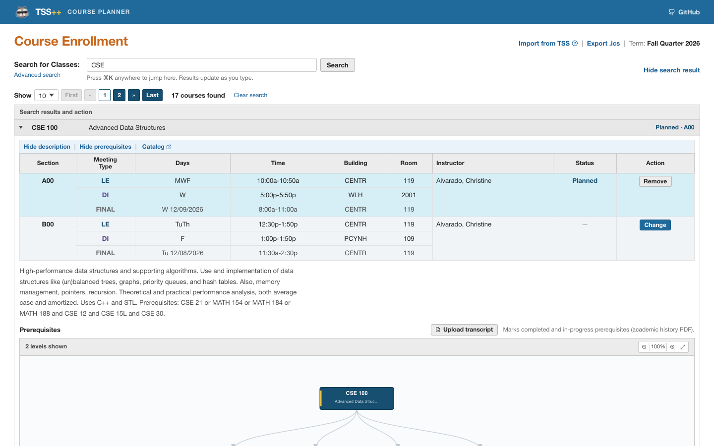
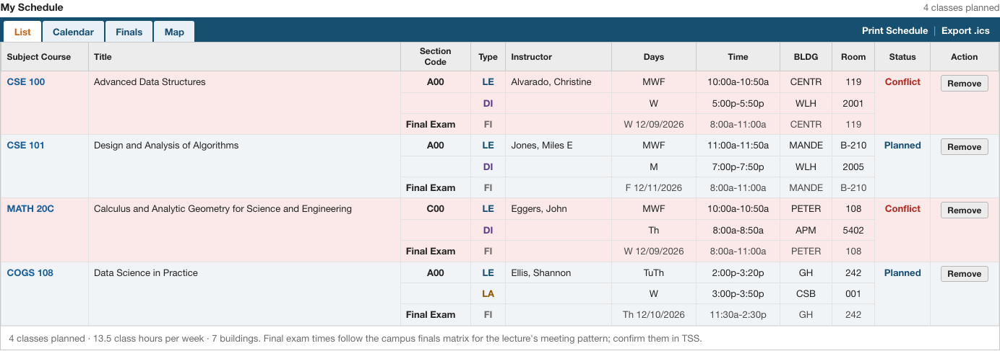
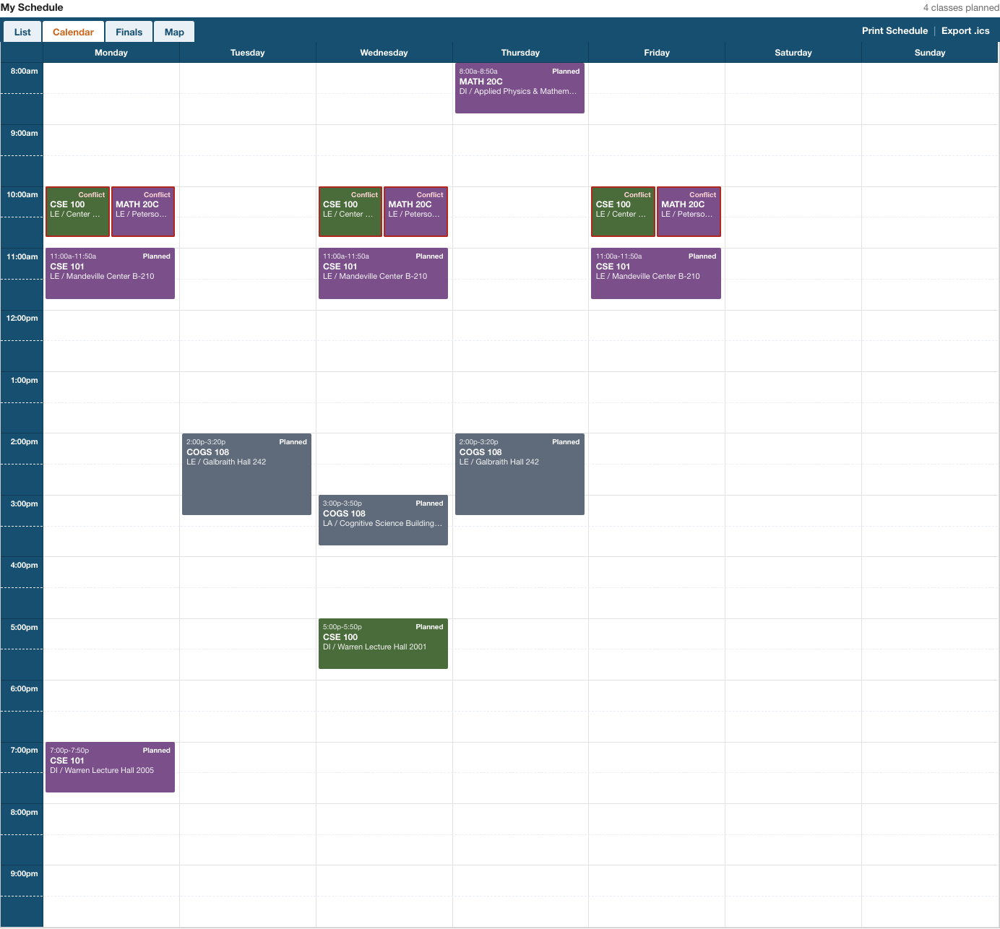
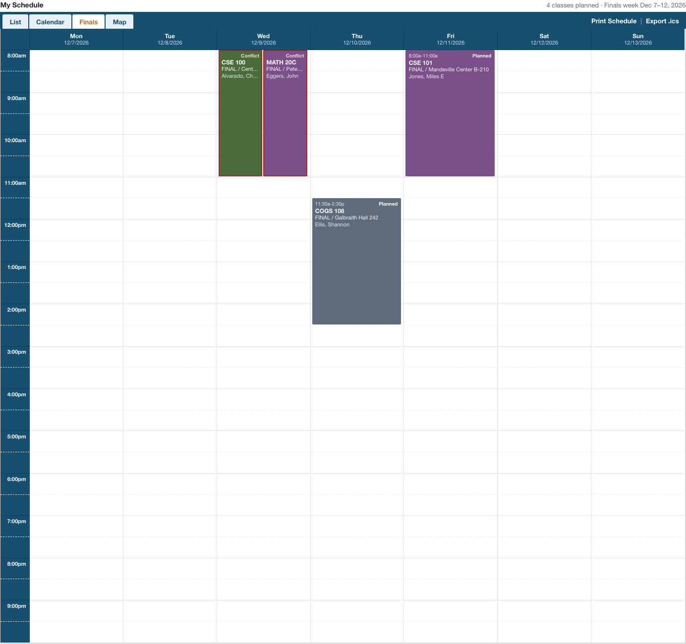
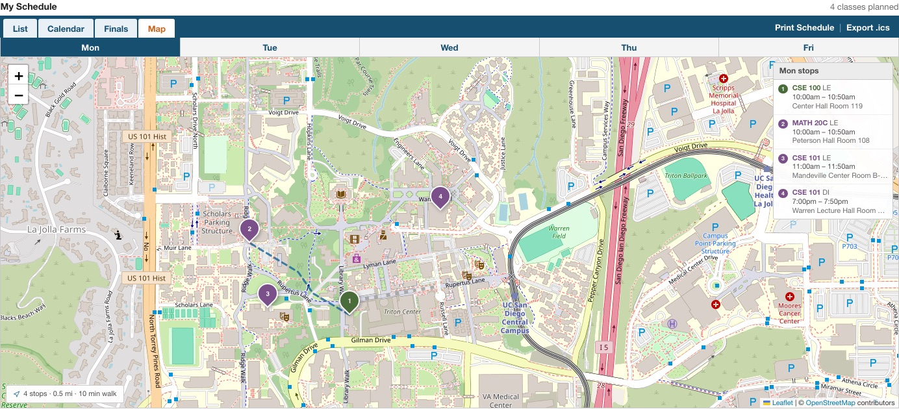
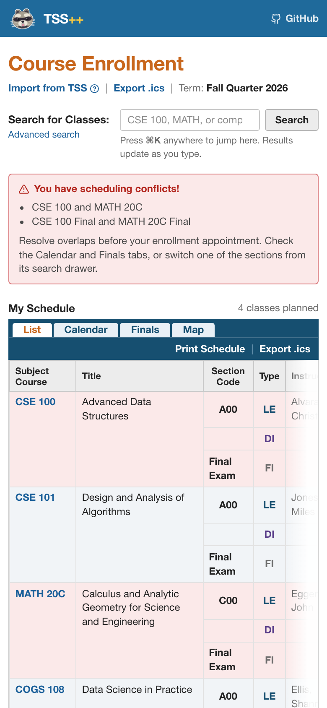

<a id="readme-top"></a>

<div align="center">

# TSS++

**A faster, more visual way to browse UCSD courses and plan your quarter.**

**200+ users · 3,500+ courses indexed · accurate quarter data**

Course search · live section data · prerequisite graphs · schedule planner · campus routing · `.ics` export

</div>

---

## Overview

On ~~7/10~~ ~~7/20~~ **7/21 at 8:00 AM PST**, UCSD replaced WebReg with the new Triton Student System (TSS). The rollout came with slow response times, outages, missing features, and a less streamlined course-planning experience.

TSS++ is an open-source alternative for browsing UCSD's schedule of classes and planning a quarter. It combines the public course catalog with live quarterly enrollment data, renders full transitive prerequisite trees, detects schedule conflicts, maps walking routes between classes, and exports schedules directly to calendar apps.

## Preview


## Screenshots

The interface takes after UCSD's retired WebReg: search on top, your schedule in
List / Calendar / Finals / Map tabs below.



| List | Calendar |
| --- | --- |
|  |  |

| Finals | Map |
| --- | --- |
|  |  |

<details>
<summary>Mobile</summary>



</details>

## Features

- **Course search** — filter by department and "offered this quarter", full-text query,
  served from the backend.
- **Course detail** — sections, meeting times, instructors, and live seat/waitlist counts.
- **Prerequisites** — an interactive, zoomable prerequisite graph in the course detail
  panel, rendering the full transitive tree
- **Schedule planner** — a FullCalendar based weekly view spanning the full week
  with automatic conflict detection; state lives in your browser (`localStorage`).
- **My Schedule list** — a WebReg-style status table of your planned quarter
  (section codes, meeting types, days, times, buildings, rooms, Final Exam rows)
  with class-hour and building totals and a conflict notice listing every
  colliding pair.
- **Campus map** — a Leaflet map pinning every planned course's building, with real
  walking routes between back-to-back meetings (proxied through OpenRouteService).
- **ICS export** — export your planned schedule to a standard `.ics` file, anchored to
  the real quarter dates.

## Built with

| Layer        | Stack                                                                            |
| ------------ | -------------------------------------------------------------------------------- |
| **Scrapers** | Python 3.11+ · httpx / requests · BeautifulSoup · MongoDB                        |
| **Backend**  | FastAPI · Pydantic · PyMongo · MongoDB                                           |
| **Frontend** | React 18 · TypeScript · Vite · Tailwind CSS v4 · FullCalendar · Leaflet · Motion |

## Architecture

The scraping pipeline writes course data to `data/` and MongoDB. The backend reads from both sources and exposes a JSON API consumed by the frontend.

```text
  scrapers/                 data/ + MongoDB              backend/                    frontend/
 ┌───────────────┐        ┌──────────────────┐        ┌─────────────────────┐     ┌──────────────────┐
 │ catalog_scraper│ write │ catalog/*.json    │  read  │ FastAPI service     │ API │ Vite + React app │
 │ tss_scraper    │ ────▶ │ courses + prereqs │ ─────▶ │ /api/courses        │────▶│ search · detail  │
 │ mark_offered…  │       │ offered flags     │        │ /api/prereqs        │HTTP │ planner · map    │
 │ build_buildings│       │ buildings.json    │        │ /api/meta           │JSON │ overview         │
 └───────────────┘        │ MongoDB           │        │ /api/buildings      │     │ ICS export       │
                          │ sections / seats   │        │ /api/route          │     └──────────────────┘
                          │ waitlist data      │        └─────────────────────┘
                          └──────────────────┘
```

## Repo structure

```text
tssplusplus/
├── scrapers/                         scraping pipeline
│   ├── catalog_scraper/              public catalog scraper
│   ├── tss_scraper/                  live TSS section/meeting scraper
│   └── helpers/
│       ├── mark_offered_courses.py   cross-references sources and marks offered courses
│       └── build_buildings.py        maps meeting locations to UCSD GIS coordinates
├── data/
│   ├── catalog/<CODE>.json           per-department course data
│   ├── offered/<term>.csv            per-term list of offered courses
│   └── buildings.json                campus building coordinates
├── backend/                           FastAPI service using data/ + MongoDB
├── frontend/                          React + TypeScript application
├── .gitignore
├── .env.template
└── requirements.txt                  shared Python dependencies
```

## Getting started

### Prerequisites

* **Python 3.11+** and pip
* **Node.js + npm** for the frontend
* **MongoDB** (local or Atlas) for section and enrollment data

### Installation

1. Clone the repository:

```sh
git clone https://github.com/alchin2/tssplusplus.git
cd tssplusplus
```

2. Install the shared Python dependencies:

```sh
pip install -r requirements.txt
```

3. Copy `.env.template` to `.env` and configure the required environment variables:

```sh
cp .env.template .env
```

> [!IMPORTANT]
> `tss_scraper` additionally requires a personal TSS login cookie. See
> [`scrapers/tss_scraper/README.md`](scrapers/tss_scraper/README.md) for the setup walkthrough.

### Running it

Run the components in order. Each component has its own README with addit
